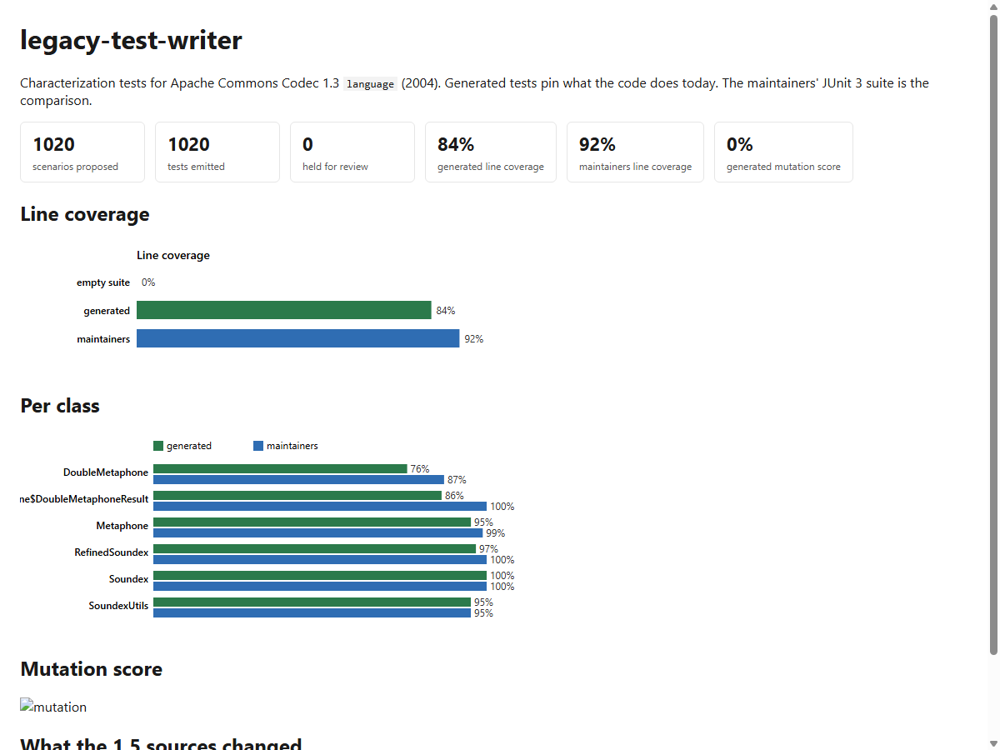
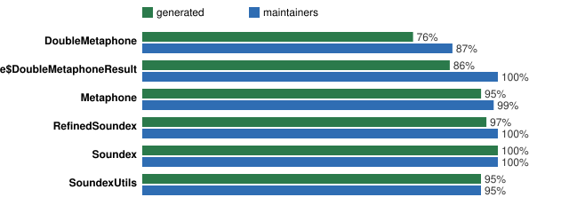
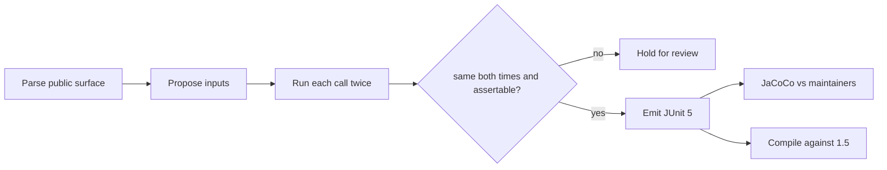

# Legacy Test Writer

**A 48-hour prototype:** an agent that reads the phonetic-encoding package of Apache Commons
Codec 1.3 (2004) and writes characterization tests that pin what the code does today. Coverage is
measured against the maintainers' own JUnit 3 suite. The same tests are compiled against the 1.5
sources to see what a later release quietly changed.

> Built to answer the question a maintainer asks before trusting generated tests:
> *"Did it freeze an accident, and would I notice if the next release broke a caller?"*
> The answer here is: observe twice, emit only what repeated, never pin an exception message,
> and fail the suite when the next release hides a public constant.




## What the eval says

Four public classes (`Soundex`, `RefinedSoundex`, `Metaphone`, `DoubleMetaphone`). 1,020 scenarios
proposed, 1,020 emitted, 0 held. Regenerated by `uv run ltw all` and committed; CI fails if any
number drops below [evals/gate.json](evals/gate.json).

| Question | Metric | Result |
|---|---|---:|
| Does the generated suite pass on the code it observed? | generated failures | **0** of 1,020 |
| How much of the package do the generated tests cover? | generated line coverage | **84%** (607 / 721) |
| How much did the maintainers cover with 74 hand-written tests? | reference line coverage | 92% (665 / 721) |
| Did a later release change the public surface? | 1.5 compile errors | **20** (`US_ENGLISH_MAPPING` became private) |
| How many observations were too unsafe to freeze? | held for review | 0 |

The eight-point coverage gap is almost all inside `DoubleMetaphone` (316 / 415 vs 362 / 415). The
maintainers wrote cases for specific letter clusters and the alternate encoding; the generator's
name corpus does not hit every silent-letter branch. That is reported, not papered over.



## What the generated tests got wrong, and how that was caught

The first Maven run failed 37 tests. Every failure was `expected: <null> but was: <>`. The probe
and the emitter used the same empty field for "the method returned null" and "the method returned
an empty string." `Soundex.clean` turns punctuation-only input into `""`, not `null`. The protocol
now treats type `null` as a null result and an empty value as `""`. That is the whole
null-vs-empty story; it is also why exception *messages* are never asserted -- they are the same
kind of accident.

`encode(Object)` declares `throws EncoderException`. The first compile failed until every test
method declared `throws Exception`. The observation was fine; the emitted Java was not.

`setMaxCodeLen(-1)` throws `NegativeArraySizeException` on 1.3. The first review pass held those
four cases as "not an expected exception." They are now tests: that is a real footgun a caller can
hit, and pinning the type (not the message) is the useful characterization.

Against Commons Codec 1.5 the generated suite does not run. Twenty tests fail to compile because
`Soundex.US_ENGLISH_MAPPING` was made private. That is the drift the 1.5 profile is for: a
characterization suite that still goes green after an API hide is not doing its job.

## How a test is produced



No LLM is required. Strategies are named and ordered: corpus names that exercise phonetic rules,
boundaries (null, empty, digits, non-ASCII as `\\uXXXX`), literals found in the class body,
setter-then-encode sequences, mapping-table constructors, and `encode(Object)` mismatches. If
`ANTHROPIC_API_KEY` is set, `--llm` may propose extra inputs. The probe still runs them twice
against the real class; a hallucinated expected value cannot reach the suite.

## Run it

JDK 17+ and Maven 3.9+ on `PATH`, or unzipped under `../.tools` as `jdk-*` and `apache-maven-*`.

```
uv sync --extra dev
uv run pytest
uv run ltw all
uv run ltw-eval --gate
```

`legacy/src/test/java` is generated. Do not hand-edit it.

Vendored sources and the maintainers' suite are Apache-2.0; see [ATTRIBUTION.md](ATTRIBUTION.md).
The tool itself is MIT.
